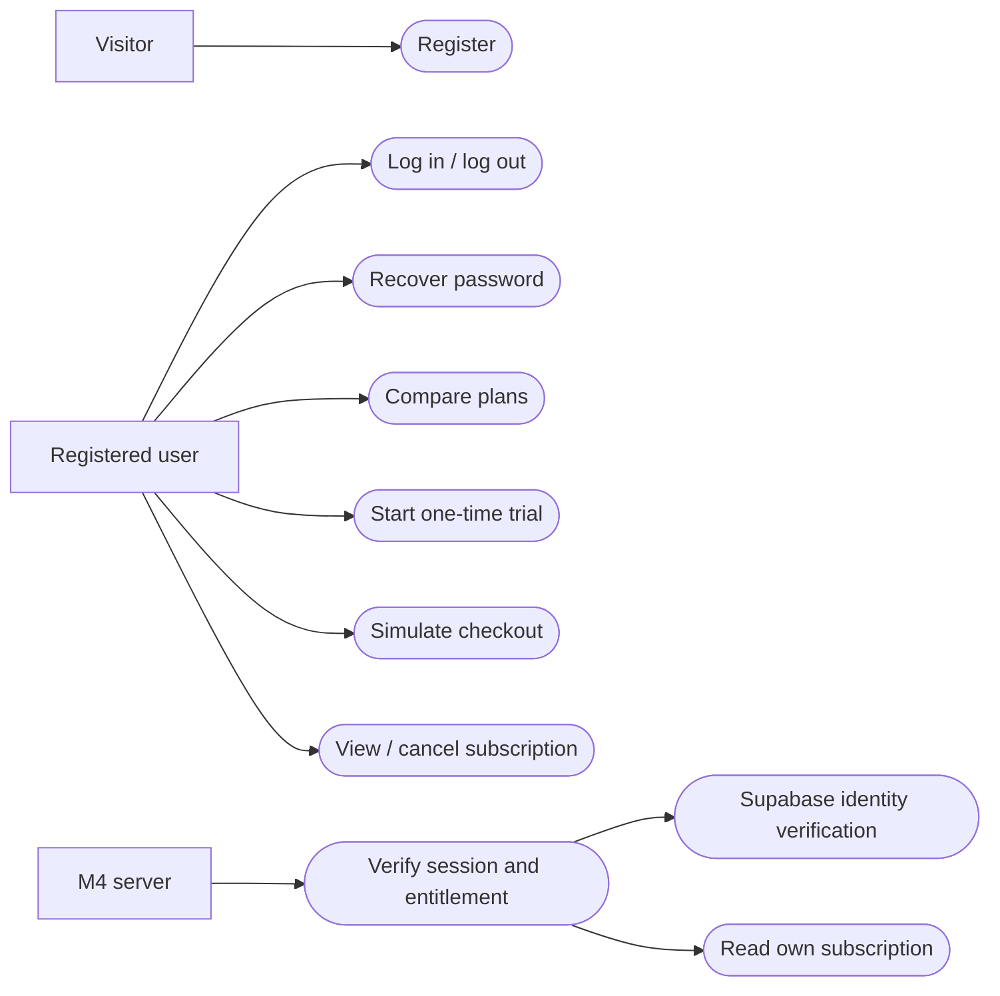
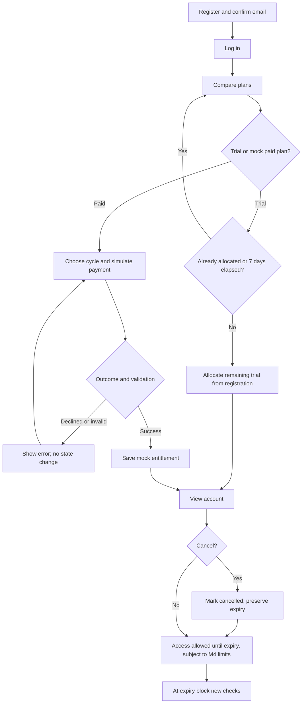
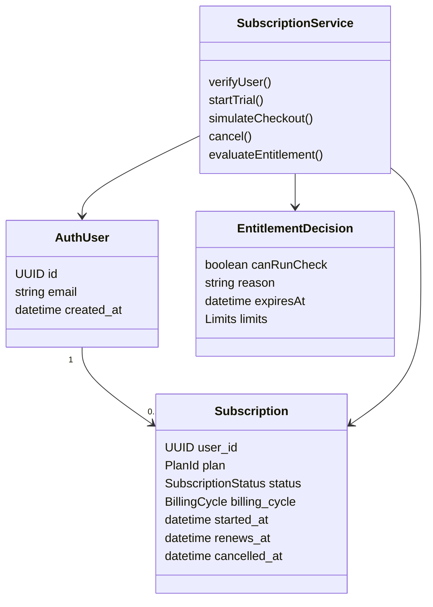
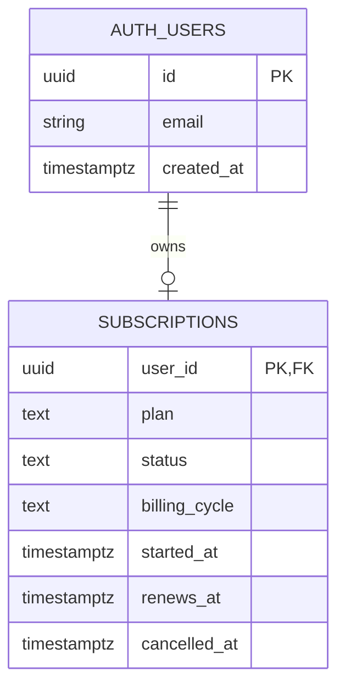

# Module 2 interim design

This design covers identity and the simulated subscription boundary. It contributes user stories, UI routes, use cases, activity, sequence, class and ER diagrams to the team's interim report. The team must integrate it with the remaining modules and review shared decisions.

## User stories and acceptance criteria

| ID | Story | Acceptance criteria |
| --- | --- | --- |
| M2-01 | As a visitor, I can register and log in. | Valid email and an 8-character signup password; confirmation guidance; invalid credentials show an error; authenticated session belongs to the verified user. |
| M2-02 | As an account holder, I can recover access. | Reset email, valid recovery link, matching new passwords, invalid-link/error states. |
| M2-03 | As a user, I can compare and choose a plan. | All three LKR plans and billing cycles; equal analysis quality; exact prices from supplied contract. |
| M2-04 | As a newly registered user, I can try the service. | Seven days from signup; one trial allocation; 15 total checks represented in entitlement; M4 enforces counts. |
| M2-05 | As a user, I can simulate checkout. | Success saves selected plan and expiry; decline leaves state unchanged; no card fields or real charges. |
| M2-06 | As a subscriber, I can view and cancel my plan. | Own row only; visible expiry; confirmation; cancellation preserves expiry; access denied at/after expiry. |
| M2-07 | As M4, I can obtain an authoritative entitlement. | Session and row checked server-side; missing/unknown/expired/suspended/past-due denied; usage controls remain required. |
| M2-08 | As a user, I receive clear promo feedback. | Unapproved codes rejected; no invented discount. Valid-code rules remain planned. |

UI routes: `/signup`, `/login`, `/forgot-password`, `/reset-password`, `/pricing`, `/checkout`, `/account/subscription`. These are implemented screens; visual acceptance and live service integration still require the checklist in `M2-INTERIM.md`.

## Use cases



## Activity diagram



## Checkout sequence

```mermaid
sequenceDiagram
  actor User
  participant UI as Checkout UI
  participant API as M2 API
  participant Auth as Supabase Auth
  participant DB as Subscription database
  User->>UI: Choose plan, cycle and mock outcome
  UI->>API: POST with bearer token
  API->>Auth: Verify token
  Auth-->>API: User identity or error
  API->>DB: Read user's current subscription
  alt Invalid identity, blocked state or invalid request
    API-->>UI: Labelled rejection
  else Simulated decline
    API-->>UI: 402; no state changes
  else Valid simulated success
    API->>DB: Trusted write with selected plan and server expiry
    DB-->>API: Saved row or conflict
    API-->>UI: Success or retryable conflict
    UI-->>User: Account subscription status
  end
```

## Class diagram



## ER diagram



One current subscription per account. Auth users belong to Supabase Auth; M2 does not store password copies. Trial allocation uses account creation and the unique subscription user ID. History, invoices, usage events and analytics tables are not invented here.

## Technology and process rationale

Next.js App Router combines UI routes with server endpoints; TypeScript defines plan/status contracts; Supabase Auth provides identity and sessions; PostgreSQL and RLS isolate subscription reads; trusted server writes protect entitlements; Tailwind and shared primitives preserve team styling. Mock payment keeps the interim demonstration independent of a gateway. This follows the existing team stack.

An incremental workflow supports a small, reviewable interim delivery: authentication, plan selection, mock entitlement, access policy and validation. Feature-branch review supports team integration and genuine contribution evidence. This is a module rationale for the team to review, not a claim that the team formally selected a particular process model.

## Remaining work and dependencies

Configure and manually verify Supabase/email and schema permissions; wire M4's provider/budget/usage controls; agree retention and history access; define approved promotions; implement paid-plan changes, invoices and notifications later. The three history windows are proposals only. Subscription/payment values never affect the Digital Safety Score.
