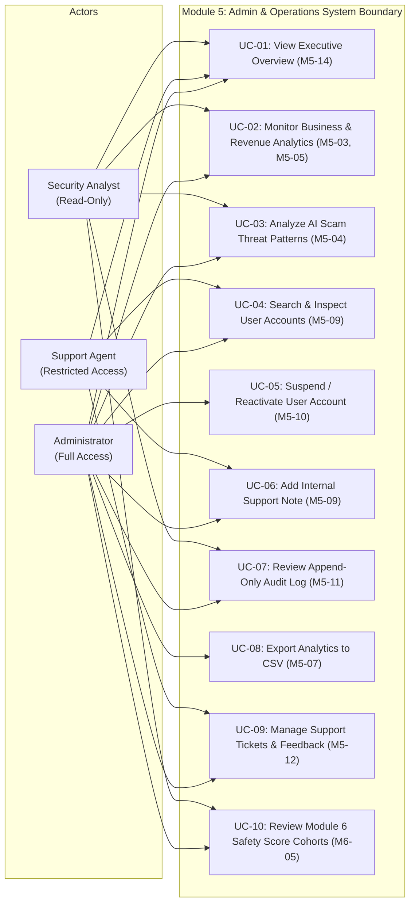
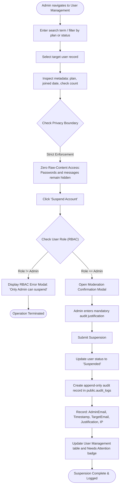
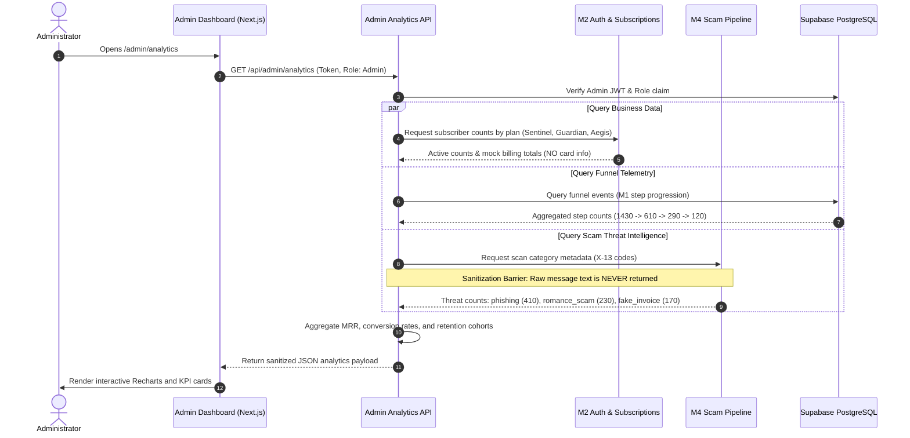
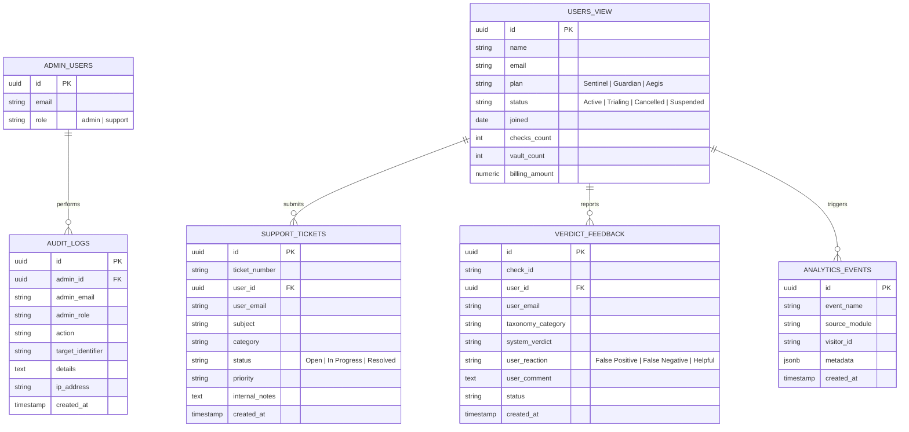

# Module 5: Admin Dashboard, Analytics and Operations
## UML Analysis and Design Diagrams

- **Project:** IS2901 Software Development Project · ScamShield
- **Group:** Byte Brigade · University of Moratuwa, Faculty of Information Technology
- **Author:** Vishmi Himaya (@Vish-Himaya) · Index No: 245027T
- **Module:** Module 5 (Admin & Operations) & Module 6 Coordinator

---

## 1. Use Case Diagram

---

## 2. Activity Diagram: Account Moderation & Audit Logging

This diagram illustrates how an administrator suspends an abusive account while enforcing Role-Based Access Control and generating an append-only audit log.

---

## 3. Sequence Diagram: Analytics Generation & Privacy Sanitization

Illustrates how Module 5 requests system telemetry while enforcing privacy boundaries.

---

## 4. Entity-Relationship (ER) & Schema Diagram

